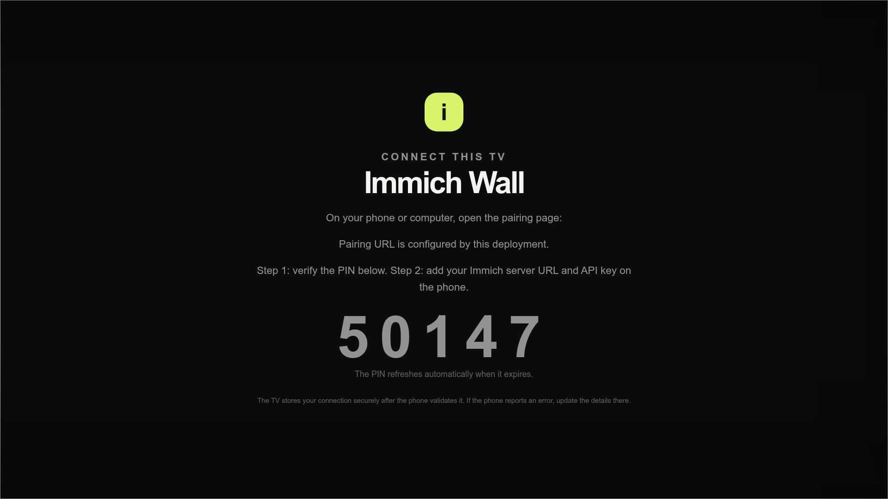
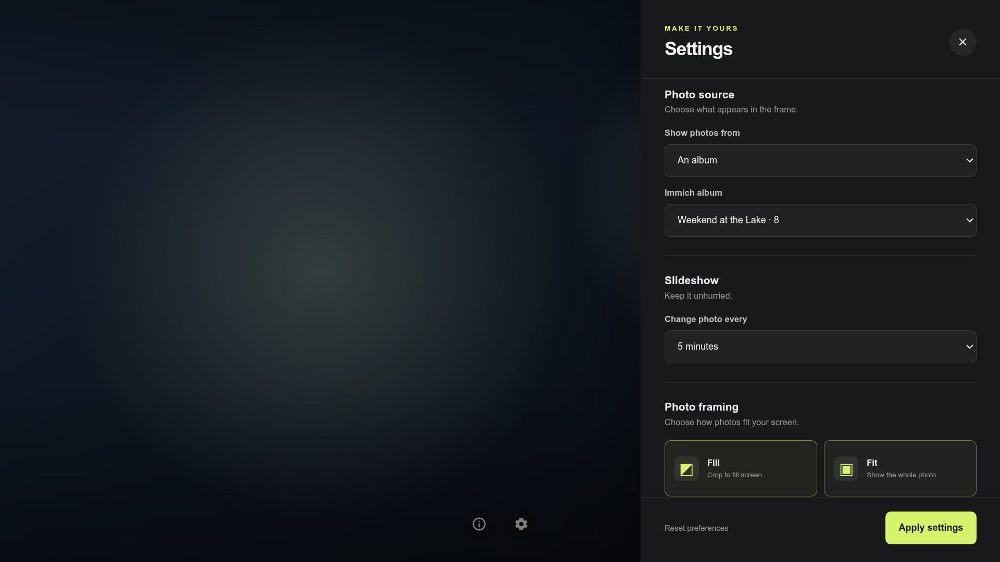

# ImmichWall for Tizen

ImmichWall is a full-screen photo frame for Samsung Tizen TVs, backed by a self-hosted Immich library. The TV and desktop browser share one frontend; a phone/computer PIN flow keeps credentials off the TV remote.

| TV setup | Settings |
| --- | --- |
|  |  |

# Features

- PIN-based phone setup: verify the TV PIN, then enter the Immich URL and read-only API key on the phone/computer.
- All photos, Favorites, or a chosen album as the slideshow source.
- Rotation intervals from 10 seconds to 60 minutes, with Cover/Contain framing.
- Server-side random image selection with album and Favorites filters; the desktop and TV use the same slideshow/settings frontend.
- TV remote controls for previous/next, settings, Play/Pause, and Unpair.
- Samsung KeyManager credential storage, with local app storage as a compatibility fallback when KeyManager is unavailable.
- The current image stays visible when Immich is unavailable; the app shows an error and retries.

# Supported Versions

- **Immich Server:** v3.1.x is the verified range. Older versions may work via the metadata-search fallback when `/api/search/random` is unavailable, but are not certified.
- **Samsung Tizen:** Tizen Web API 2.4 or later is declared; physical verification has been done on Tizen 5.5.
- **Node.js:** 20 or later for development, tests, and the server.

# Getting Started

- Configure `PAIRING_BASE_URL`, `IMMICH_SERVER_URL`, and TV deployment values in a local, gitignored `.env` copied from `.env.example`.
- Make the pairing/server host available over HTTPS through a reverse proxy.
- Run `npm run deploy` to build, install, and launch the TV app.
- Pair from a phone/computer, then choose the source, interval, and framing in Settings.
- Follow [Getting-Started.md](Getting-Started.md) for prerequisites and the full setup walkthrough.

# Contribution

**Tech stack:** shared vanilla JavaScript/HTML/CSS frontend, Node.js 20+, Express 5, Immich REST API, Samsung Tizen Web Device APIs, and Playwright.

```sh
npm ci
npm start                         # local desktop/server development
npm run check                     # syntax, assets, Tizen XML and TV JS compatibility
npm run test:unit                 # unit tests
npm run test:integration          # server/API tests
npm run test:e2e                  # desktop, pairing, and TV-mode browser tests
npm run test:all                  # all checks and tests
npm run screenshots               # regenerate the face-free README screenshots
npm run deploy                    # build, install, and launch on the TV from .env
```

The optional live, read-only Immich smoke test is explicit: `LIVE_IMMICH=1 npm run test:live`.
